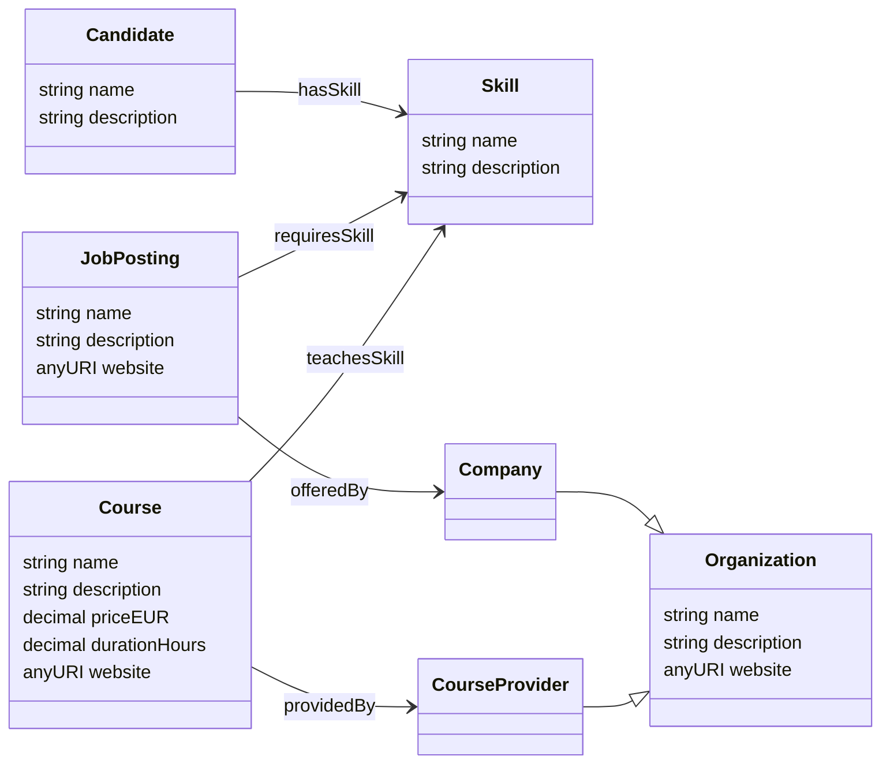

# 2. Ontology Design

## Purpose and Files

The ontology follows the [domain, rules, and eight competency questions](01_DOMAIN_AND_PURPOSE.md). It contains **7 named classes and 10 domain properties**: 5 object properties and 5 datatype properties.

- [ontology.ttl](ontology.ttl): the formal ontology in Turtle.
- This document: the model description, conceptual diagram, competency question mapping, and a brief consistency check result.

Prefixes and identifiers:

| Purpose | IRI |
| --- | --- |
| Ontology | `https://example.org/it-learning/ontology` |
| Prefix `onto:` | `https://example.org/it-learning/ontology#` |
| Future data objects, prefix `data:` | `https://example.org/it-learning/data/` |

`example.org` provides a namespace for this academic model, rather than a published service. Term names, `rdfs:label` annotations, and `rdfs:comment` annotations are in English. The annotations use the language tag `@en`.

## Classes

| Class | Meaning |
| --- | --- |
| `Candidate` | A candidate with recorded skills. |
| `Skill` | A skill without a proficiency level, such as SQL or Python. |
| `JobPosting` | A particular job posting with mandatory skill requirements. |
| `Course` | A course that teaches skills and has a price and duration. |
| `Organization` | A shared superclass for organizations. |
| `Company` | An organization acting as the employer for a posting. |
| `CourseProvider` | An organization providing a course. |

`Company` and `CourseProvider` are subclasses of `Organization`. One organization may belong to both classes. In that case, use one data object with both types.

A job posting represents a particular advertisement; two postings titled "Python developer" have separate identifiers. Job role categories, certificates, and skill proficiency levels do not have separate classes in this version because the agreed questions do not require them.

## Conceptual Diagram

The diagram is displayed by Markdown viewers that support Mermaid, including GitHub. A hollow triangle arrow denotes inheritance; the other arrows represent object properties.

## Object Properties

| Property | Domain | Range | Meaning |
| --- | --- | --- | --- |
| `hasSkill` | `Candidate` | `Skill` | A skill recorded for a candidate. |
| `requiresSkill` | `JobPosting` | `Skill` | A mandatory skill required by a posting. |
| `offeredBy` | `JobPosting` | `Company` | The company acting as the employer for a posting. |
| `teachesSkill` | `Course` | `Skill` | A skill taught by a course. |
| `providedBy` | `Course` | `CourseProvider` | The provider of a course. |

The number of links is not currently restricted by OWL cardinalities. Required links and their allowed counts will be addressed by SHACL validation in step 6.

## Datatype Properties

| Property | Domain | Datatype | Meaning |
| --- | --- | --- | --- |
| `name` | `owl:Thing` | `xsd:string` | The name or title of a particular object. |
| `description` | `owl:Thing` | `xsd:string` | A description of a particular object. |
| `priceEUR` | `Course` | `xsd:decimal` | The course price in EUR; `0.0` for a free course. |
| `durationHours` | `Course` | `xsd:decimal` | Course duration in hours, including fractional values. |
| `website` | `Organization` or `Course` or `JobPosting` | `xsd:anyURI` | The object's web address. |

`name` and `description` are general properties with domain `owl:Thing`; they do not introduce another custom class. The domain of `website` is the **union** of three classes using `owl:unionOf`, rather than three separate `rdfs:domain` declarations, which would express an intersection.

Prices use a single currency, EUR, and durations use a single unit, hours. An unknown price must not be replaced with zero; zero means the course is free. SHACL will define rules for required values, non-negative prices, and positive durations.

## Axioms and Logical Rules

1. `Company` is a subclass of `Organization`.
2. `CourseProvider` is a subclass of `Organization`.
3. `Candidate`, `Skill`, `JobPosting`, `Course`, and `Organization` are mutually disjoint. An object cannot, for example, be both a candidate and a skill.
4. `Company` and `CourseProvider` are not disjoint: one organization may have both roles.
5. Every domain property has a domain and range; datatype properties specify a datatype.
6. Every named class and domain property has `rdfs:label` and `rdfs:comment` annotations in English, tagged `@en`.

Property domains and ranges support type inference. For example, a link `posting offeredBy organization` allows the organization to be inferred as a `Company`. These declarations do not replace checks for required information. Logical consistency and data completeness are separate checks.

The model follows the open-world semantics of RDF/OWL: a missing `hasSkill` link is not proof that a person lacks the skill. For recommendations, however, we will **compare the complete recorded lists of skills and mandatory requirements within the dataset**. If a required skill is not recorded in the candidate's profile, the calculation treats it as uncovered. This assumption must also be stated when explaining the results.

## Derivation from Competency Questions

| Question | Required model elements | Use |
| --- | --- | --- |
| CQ1 | `Candidate`, `JobPosting`, `hasSkill`, `requiresSkill` | Find postings without an uncovered mandatory skill. |
| CQ2 | `hasSkill`, `requiresSkill` | Compute the difference between required and recorded skills. |
| CQ3 | `Course`, `teachesSkill`, the preceding difference | Find courses teaching at least one missing skill; an individual course need not cover every requirement. |
| CQ4 | `Course`, `hasSkill`, `requiresSkill`, `teachesSkill` | Combine original skills with those gained from the course and count only additional qualifying postings. |
| CQ5 | The same elements as CQ4 | Return the specific additional postings for a selected course. |
| CQ6 | `requiresSkill` | Count distinct postings requiring each skill. |
| CQ7 | The elements of CQ4 and `priceEUR` | Divide price by the number of additional postings; compare only courses with a positive number of additional postings. |
| CQ8 | `offeredBy`, `requiresSkill`, `hasSkill` | Count missing skills per posting and calculate the average per company. Include postings with zero missing skills. |

`name` supports readable results. `description`, `website`, and `durationHours` provide context and the supplementary information agreed in step 1.

## Rules for Future Data and Queries

- Each skill has one stable identifier across profiles, postings, and courses. Different wording does not automatically create a new skill.
- The `name` and `description` properties on data objects use `xsd:string` literals. Ontology annotations `rdfs:label` and `rdfs:comment` use English text tagged `@en`.
- Price and duration are decimal values. A web address is an `xsd:anyURI` literal, rather than an ordinary string or a replacement for the object's IRI.
- Courses are evaluated independently without changing the stored candidate profile. Skills are added hypothetically when calculating a recommendation.
- The main ranking uses the number of additional postings, without incorporating price or duration. If several courses share the highest count, all of them answer the main question.
- Count distinct job postings, rather than their skills or paths through the graph.
- This step defines the schema. The dataset is described in [Data overview](04_DATA.md); the final SPARQL queries will be prepared in step 5.

## Validation and Next Steps

The Turtle ontology was parsed successfully and checked with the HermiT reasoner. It contains 7 named classes and 10 domain properties; all named classes are satisfiable, and no logical inconsistency was found. Every class and property has English `rdfs:label` and `rdfs:comment` annotations.

A small example confirmed that the recommendation rule counts only additional qualifying postings. The reasoner also correctly detected a deliberately invalid object belonging to both `Candidate` and `Skill`. The required SHACL shapes for checking data completeness and value constraints will be added in step 6.

We reviewed Schema.org, ESCO, and SKOS and decided to keep our current classes and properties. The [short vocabulary comparison](03_VOCABULARY_RESEARCH.md) explains why.

Technical references:

- [W3C: RDF Schema 1.1 - classes, properties, domains, and ranges](https://www.w3.org/TR/rdf-schema/).
- [W3C: OWL 2 Primer - hierarchies, disjointness, and the open-world assumption](https://www.w3.org/TR/owl2-primer/).
